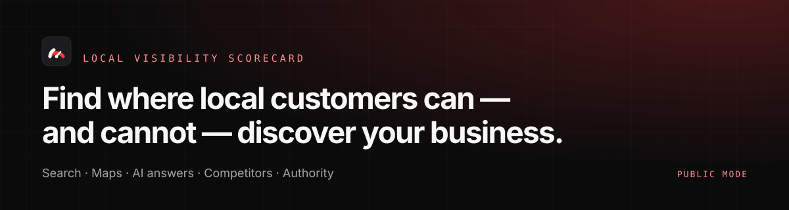
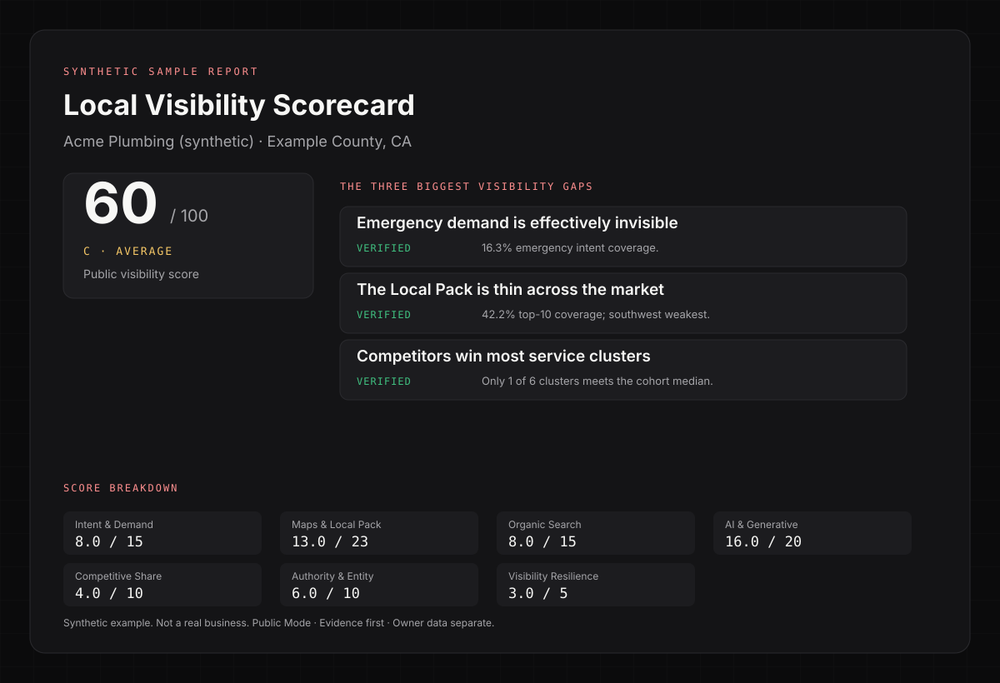

# Local Visibility Scorecard

**Find where local customers can — and cannot — discover your business.**

[](https://github.com/thatguynef/local-visibility-scorecard/actions/workflows/ci.yml)
[](LICENSE)
[](CHANGELOG.md)
[](package.json)
[](package.json)

> [!NOTE]
> **Built for local home-service businesses** — plumbing, HVAC, roofing, electrical, pest control, garage door, landscaping, restoration, cleaning, and similar trades. It is also for the marketers, agencies, and analysts who serve them. Read the [audience guide](docs/audience.md).

| At a glance | |
|---|---|
| **The question** | When local customers search or ask for the services this business provides, how visible is it across the discovery surfaces that matter? |
| **The output** | A 0–100 visibility score, a contractor-facing one-pager, a full evidence report, and the owner-data questions public data cannot answer |
| **The rule** | Visibility outcomes are scored. GBP configuration and website conversion belong to the sibling scorecards. |
| **What it is not** | A generic SEO audit, a rank tracker, a citation checklist, a GEO magic product, a SaaS dashboard, or a guarantee of revenue lift |



*Synthetic example — not a real business. Read the [one-page report](examples/acme-plumbing/one-page.md) or the [full audit](examples/acme-plumbing/full-report.md).*

## Who it's for

**Local home-service businesses** — the trades people call when something at home is broken, dirty, unsafe, or overdue. If customers find you in Google Search, Maps, an AI answer, or a directory, this framework was written for you.

It is also for the people who run the marketing: in-house marketers, local agencies, consultants, and analysts who need a repeatable, evidence-based second opinion instead of another keyword spreadsheet.

**Not a fit:** SaaS, e-commerce, national brands with mature analytics teams, and anyone looking for a guaranteed revenue lift or an automated fix. [Read the audience guide →](docs/audience.md)

## Part of the scorecard family

This is the discovery layer of a three-part diagnostic. Each score is independently meaningful, and none rewrites another.

| Scorecard | Question it answers |
|---|---|
| **Local Visibility** (this repository) | Can prospective customers discover the business across Search, Maps, AI answers, competitors, and external authority? |
| [GBP Scorecard](https://thatguynef.github.io/gbp-scorecard/) | Does the Google Business Profile create trust and enable action? |
| [Website Scorecard](https://thatguynef.github.io/website-scorecard/) | Can the owned website convert that demand? |

The ownership boundaries, shared evidence states, and the RAD handoff are documented in [The Scorecard Family](docs/scorecard-family.md).

## Quick start

Requirements: Node.js 22+ and Python 3.10+. No runtime npm dependencies.

```sh
git clone https://github.com/thatguynef/local-visibility-scorecard.git
cd local-visibility-scorecard
npm run doctor
npm test
npm run verify:example
```

Run the synthetic fixture end to end without credentials or network access:

```sh
npm run collect -- \
  --fixture .opencode/skills/home-service-local-visibility-audit/scripts/fixtures/acme-plumbing.raw.json \
  --out .audit/acme-plumbing/demo \
  --run-id demo
```

The collector writes a **pending worksheet**. A reviewer fills the five judgment checks; then the scorer, renderer, and verifier run as separate stages. The complete workflow is in [Run an audit](docs/run-an-audit.md).

## What it measures

| Category | Weight | Question |
|---|---:|---|
| A. Intent & Demand Coverage | 15 | Across the commercially meaningful things customers search for, how broadly is the business visible? |
| B. Maps & Local Pack Visibility | 25 | How consistently does it appear prominently in Google's local-business results throughout the market? |
| C. Organic Search Visibility | 15 | How well does it appear in ordinary Google results for commercially relevant local intent? |
| D. AI & Generative Visibility | 20 | When customers ask AI systems for recommendations, how often and how credibly does it appear? |
| E. Competitive Share of Visibility | 10 | Relative to real local competitors, what share of discovery does it earn? |
| F. Authority & Entity Footprint | 10 | How strongly is it corroborated across external sources that support discovery and recommendation? |
| G. Visibility Resilience | 5 | Is discoverability diversified, or does it depend on one fragile source? |
| **Total** | **100** | |

Bands: 90–100 A · 75–89 B · 60–74 C · 40–59 D · 0–39 F.

The score is not a keyword count. Maps and the Local Pack receive the highest weight because local-business results are the densest discovery surface. AI receives the second-highest weight because AI answers are now a real recommendation surface, but only validated surfaces contribute. N/A checks are removed from the denominator. Owner-data questions never reduce the public score.

Full math, validity gates, and a worked example: [Scoring](docs/scoring.md). Canonical source: `.opencode/skills/home-service-local-visibility-audit/references/rubric.json`.

## Evidence rules

Every finding is one of:

- **VERIFIED** — directly observed or safely measured.
- **STRONG SIGNAL** — the observation is real, but the business outcome cannot be proven from public data.
- **OWNER DATA REQUIRED** — cannot responsibly determine from public information.
- **NOT APPLICABLE** — the check does not reasonably apply to this business, category, geography, configuration, or audit mode.

> [!IMPORTANT]
> The system never says "this business is losing jobs." It says "the business is absent from the top 10 for 4 of 6 service clusters" and asks the owner for the clicks, leads, and revenue that public data cannot show.

Read [Evidence](docs/evidence.md).

## The query universe is locked before collection

The biggest methodological risk in a visibility score is choosing keywords after seeing the results. The framework defines the market, services, intents, demand weights, and AI prompts first; hashes the universe; and refuses to score a run whose universe changed.

The hash is carried into `audit.json`, `audit.filled.json`, `scores.json`, and `verification.json`. Read [Query universe](docs/query-universe.md).

## Geo-grid and AI

- **Geo-grid:** configurable 3×3, 5×5, 7×7, or custom. The default is 7×7 / 49 points. Local Pack, Google Maps, and Local Finder are separate surfaces. Read [Geo-grid methodology](docs/geo-grid.md).
- **AI visibility:** every observation records platform, product surface, source type, method, provider, prompt, market, language, timestamp, repeat, model/version where available, and citation behavior. Mention, recommendation, and citation are stored separately. Consumer/search surfaces and model/API responses are never pooled. Read [AI visibility](docs/ai-visibility.md).

## Public Mode and Connected Mode

**Public Mode** uses DataForSEO as the implementation provider: SERP, Maps, Local Finder, AI Mode, LLM Mentions, backlinks, and business listings. It assumes no ownership authorization.

**Connected / Authorized Mode** is a documented future mode. It will use authorized Search Console, GA4, Google Ads, Microsoft/Bing, or client revenue data. Connected diagnostics will be reported separately and will not silently change the Public Mode score.

Every run records its `audit_mode`. The two modes are never mixed.

## Cost safety

Live audits call paid APIs. The collector requires an explicit plan before sending a request:

```sh
export DATAFORSEO_LOGIN="..."
export DATAFORSEO_PASSWORD="..."
npm run audit -- --config config/market.example.json --plan
```

It shows core keywords, grid points, Maps tasks, organic tasks, AI prompt tasks, competitor and authority tasks, total task count, and the configured ceilings. `--dry-run` sends no paid request. `--max-serp-tasks`, `--max-ai-tasks`, and `--max-cost-usd` are enforced. `--max-cost-usd` requires `--pricing` with real local prices; the tool will not invent a provider price.

## Privacy and security

This is a public repository. Raw evidence, client reports, `.env` files, DataForSEO credentials (`DATAFORSEO_LOGIN` + `DATAFORSEO_PASSWORD`, or a pre-encoded `DATAFORSEO_BASIC_AUTH`), Basic Authorization values, raw API responses, geo-grid coordinates, prompts, and connected-account data stay local.

```sh
npm run check:privacy
node scripts/privacy_scan.mjs --history
```

The scanner checks tracked and untracked files for credentials, PII patterns, forbidden evidence paths, and private-client artifacts. It never prints the detected value. CI uses synthetic fixtures and makes no DataForSEO or live-model request.

Never open a public issue containing a live credential. See [SECURITY.md](SECURITY.md) and [Privacy](docs/privacy.md).

## Project structure

```text
.opencode/skills/home-service-local-visibility-audit/
  SKILL.md                    audit workflow
  references/
    rubric.json               canonical V1 rubric
    rubric.md                 generated
    coverage-matrix.json      generated
    portable-checklist.md     generated
    fix-library.md            generated
    one-page-template.md
    report-template.md
    schema/                   raw audit, filled audit, scores, judgment, verification, query universe
  scripts/
    build_universe.mjs        query-universe builder and hash
    collect.mjs               public collector (fixture-first)
    score.py                  validator + deterministic scorer
    render.mjs                one-page + full report
    verify.mjs                invariants + mutation tests
    apply_judgment.mjs        structured model/reviewer merge
    eval.mjs                  offline judgment eval harness
    providers/dataforseo/     provider layer
    lib/                      metrics, grid, plan, universe
    fixtures/                 synthetic fixtures
examples/acme-plumbing/       synthetic public example
docs/                         MkDocs site
scripts/                      privacy, links, assets, schemas, doctor, audit
```

The same content deploys to [thatguynef.github.io/local-visibility-scorecard](https://thatguynef.github.io/local-visibility-scorecard/) through `.github/workflows/docs.yml`.

## Documentation

Start with [Who this is for](docs/audience.md), then [Run an audit](docs/run-an-audit.md) and [Why this exists](docs/why-this-exists.md). The full index is [docs/README.md](docs/README.md).

## Why it exists

Traditional local SEO tools report activity: keyword counts, field completion, backlink totals. A business can look "optimized" and still be absent when a customer nearby needs the work.

Local Visibility Scorecard diagnoses observable discovery across Search, Maps, AI answers, competitors, and external authority. It separates verified visibility gaps from owner-data questions, and it does not pretend the public web can show clicks, leads, or revenue.

## The scorecard family

```text
LOCAL VISIBILITY SCORECARD
Can they discover you?
        ↓
GBP SCORECARD
Do they trust and act?
        ↓
WEBSITE SCORECARD
Do they convert?
        ↓
RAD
Respond · Book · Follow up · Measure
```

Each score remains independently meaningful. RAD may later consume the machine-readable findings; it must never merge or rewrite the public scores. See [The Scorecard Family](docs/scorecard-family.md).

## Status

V1 is a deterministic, fixture-first public-mode implementation. Connected mode, additional AI adapters, and RAD integration are future work. The diagnostic engine stays separate from remediation.

## License

MIT. See [LICENSE](LICENSE).
