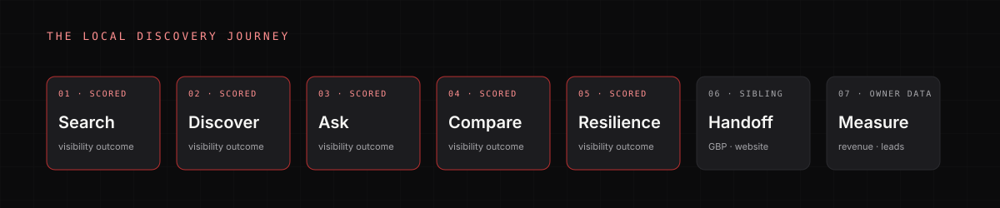

# Framework

Local Visibility Scorecard follows the customer's discovery journey, not a keyword list.

```text
SEARCH / ASK → DISCOVER → COMPARE → SELECT → GBP / WEBSITE
                                        ↓
                                   RAD / OPERATIONS
```

Local Visibility owns the first three transitions and the resilience question behind them. GBP and Website own the conversion surfaces after the customer has chosen a business.

## The seven journey stages

| # | Stage | Customer question | Coverage |
|---:|---|---|---|
| 1 | Search | When a customer searches for the service, does the business appear across the demand it sells? | Scored |
| 2 | Discover | Does it appear in Maps, the Local Pack, and organic results throughout the market? | Scored |
| 3 | Ask | When a customer asks an AI system for a recommendation, is it mentioned, recommended, and cited? | Scored |
| 4 | Compare | How does its share of discovery compare with real local competitors and credible sources? | Scored |
| 5 | Resilience | Would it still be discoverable if one surface, service, or area weakened? | Scored |
| 6 | Handoff | Do the Google Business Profile and owned website create trust and convert? | Not scored here |
| 7 | Measure | Can discovery-origin demand be tied to leads, jobs, and revenue? | Owner data required |



## The seven categories

| Category | Weight | Question |
|---|---:|---|
| A. Intent & Demand Coverage | 15 | Across the commercially meaningful things customers search for, how broadly is the business visible? |
| B. Maps & Local Pack Visibility | 25 | How consistently does it appear prominently in Google's local-business results throughout the market? |
| C. Organic Search Visibility | 15 | How well does it appear in ordinary Google results for commercially relevant local intent? |
| D. AI & Generative Visibility | 20 | When customers ask AI systems for recommendations, how often and how credibly does it appear? |
| E. Competitive Share of Visibility | 10 | Relative to the businesses competing for the same demand, what share of discovery does it earn? |
| F. Authority & Entity Footprint | 10 | How strongly is it corroborated across external sources that support discovery and recommendation? |
| G. Visibility Resilience | 5 | Is discoverability diversified, or does it depend on one fragile source? |
| **Total** | **100** | |

Maps and the Local Pack receive the highest weight because local-business results are the densest discovery surface for a home-service business. AI receives the second-highest weight because AI answers are now a real recommendation surface, but only validated surfaces contribute to the score.

## What is deliberately excluded

- **GBP category, service, hours, attributes, photos, reviews, action paths, or profile-origin tracking.** These belong to GBP Scorecard. Local Visibility may use a GBP finding as explanatory context, but it does not score it again.
- **Page speed, mobile UX, forms, CTA usability, on-site schema, booking flow, or website measurement.** These belong to Website Scorecard. Local Visibility may identify which URL ranks; it does not judge whether the page converts.
- **Paid visibility as a penalty.** Search Ads and Local Services Ads are reported as diagnostic. Their absence never lowers the score.
- **Branded visibility as core proof.** Branded queries are tracked, but they are diagnostic and do not inflate the core score.
- **Raw backlink quantity.** Authority is judged by relevance, local corroboration, and competitor context.
- **Owner-reported revenue as a public input.** Owner data is reported separately.

## Core and optional diagnostics

**Core scored:** non-branded local search, Maps / Local Pack, organic, validated AI surfaces, competitor share, authority/entity footprint, resilience.

**Diagnostic, unscored:** branded search, paid search and Local Services Ads, secondary engines, Apple Maps, Bing Maps, Nextdoor, Yelp, YouTube, local sponsorships, manufacturer directories, new service areas, content expansion.

See [Coverage and completeness](coverage-completeness.md).

## Applicability

Not every business has the same discovery surface. Configuration determines applicability:

```json
{
  "trade": "plumbing",
  "market": "Example County, CA",
  "emergency_service": true,
  "near_me_demand": true,
  "city_modified_demand": true,
  "local_finder_configured": false,
  "branded_diagnostics_enabled": true,
  "historical_runs_available": false,
  "ai_repeats": 3,
  "grid_size": 7,
  "max_queries": 40
}
```

When a conditional check is disabled, it is N/A and removed from the denominator. `NOT APPLICABLE` means the check does not apply. It never means "unknown," "provider failed," or "the business is bad."

## Validity before scoring

The framework does not score an incomplete observation set. If the target is unresolved, the query universe is unlocked, core query coverage is low, grid coverage is low, AI repeats are incomplete, the competitor cohort is unlocked, or the provider error rate is too high, the run returns **INSUFFICIENT EVIDENCE**. See [Scoring](scoring.md#validity-gates).

## Canonical source

The machine-readable rubric is `.opencode/skills/home-service-local-visibility-audit/references/rubric.json`. It contains 52 checks, each with an ID, category, weight, journey stage, evidence types, evaluation method, applicability, severity, anchors, and recommended intervention.

Generated artifacts:

- [Canonical rubric](rubric.md)
- `coverage-matrix.json`
- `portable-checklist.md`
- [Fix library](fix-library.md)

Do not hand-edit generated files.
