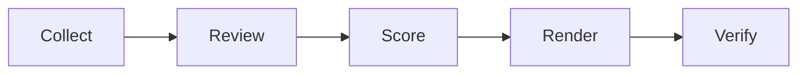

---
hide:
  - navigation
  - toc
description: "Find where local customers can — and cannot — discover a home-service business across Search, Maps, AI answers, competitors, and external authority."
---

<section class="lv-hero">
  <div>
    <p class="lv-eyebrow">FOR LOCAL HOME-SERVICE BUSINESSES</p>
    <h1>Find where local customers can — and cannot — discover your business.</h1>
    <p class="lv-lede">Local Visibility Scorecard measures observable visibility across Search, Maps, AI answers, competitors, and external authority — then separates verified visibility gaps from questions that require owner data.</p>
    <div class="lv-actions">
      <a class="lv-btn lv-btn--primary" href="run-an-audit/">Run an audit</a>
      <a class="lv-btn" href="audience/">Who it's for</a>
      <a class="lv-btn" href="framework/">See the framework</a>
    </div>
    <p class="lv-trades">Plumbing · HVAC · Roofing · Electrical · Pest control · Garage door · Landscaping · Restoration · Cleaning</p>
  </div>
  <figure class="lv-hero__media">
    
    <figcaption>Synthetic sample report</figcaption>
  </figure>
</section>

## What you get

<div class="grid cards lv-cards-4" markdown>

-   :material-map-search:{ .lg .middle } **A visibility score you can defend**

    ---

    A 0–100 score across seven weighted categories. Maps and the Local Pack receive the highest weight because local-business results are the densest discovery surface. N/A checks leave the denominator.

-   :material-file-document-outline:{ .lg .middle } **A report a contractor will read**

    ---

    Three visibility gaps, the evidence behind each, the fix, and the questions only the owner can answer.

-   :material-magnify-scan:{ .lg .middle } **Evidence states, not opinions**

    ---

    VERIFIED, STRONG SIGNAL, OWNER DATA REQUIRED, or NOT APPLICABLE. Every finding is labeled.

-   :material-database-outline:{ .lg .middle } **Machine-readable output**

    ---

    `audit.json`, `audit.filled.json`, `scores.json`, `query-universe.json`, a coverage matrix, and a verification gate for future RAD ingestion.

</div>

## How it works



Collection is read-only and uses DataForSEO as an implementation provider. Only judgment checks use a model or reviewer. Scoring, rendering, and verification are file-based and reproducible. Read the [architecture](architecture.md) if you want the details.

The score answers:

> When prospective local customers search or ask for the services this business provides, how visible is the business across the discovery surfaces that matter?

It does not answer:

> Whether every SEO field is complete, or how many raw backlinks exist.

## What this is not

It is not a generic SEO audit, a rank tracker, a citation checklist, a GEO magic product, a SaaS dashboard, or a guarantee of revenue lift.

It is not the [GBP Scorecard](https://thatguynef.github.io/gbp-scorecard/) with search rankings added. Local Visibility diagnoses discovery. GBP diagnoses profile trust and action. [Website Scorecard](https://thatguynef.github.io/website-scorecard/) diagnoses conversion.

## Start here

<div class="grid cards" markdown>

-   **I own or market a home-service business**

    ---

    Start with [who this is for](audience.md) and [why this exists](why-this-exists.md).

-   **I want to run an audit**

    ---

    Use the synthetic fixture first, then a configured public audit. See [Run an audit](run-an-audit.md).

-   **I want to extend the rubric**

    ---

    Read [Architecture](architecture.md), [Evidence](evidence.md), and [Scoring](scoring.md) before adding a check.

</div>

## A coordinated scorecard family

```text
LOCAL VISIBILITY SCORECARD
Can prospective customers discover the business?
                 ↓
GBP SCORECARD
Does the profile create trust and enable action?
                 ↓
WEBSITE SCORECARD
Can the owned website convert that demand?
                 ↓
RAD
Remediation and operations live elsewhere.
```

Local Visibility stops at discovery and comparison. [GBP Scorecard](https://thatguynef.github.io/gbp-scorecard/) diagnoses the profile. [Website Scorecard](https://thatguynef.github.io/website-scorecard/) diagnoses the owned site. The boundaries are explicit in [The Scorecard Family](scorecard-family.md).

> [!NOTE]
> Every public example is synthetic or sanitized. The repository never ships real client screenshots, reports, customer data, geo-grid coordinates, or connected-account data. The scorecard diagnoses; remediation is a separate system.

Local Visibility Scorecard is maintained alongside [Radical Red Rocket](https://radicalredrocket.com), which uses it as a diagnostic framework behind local visibility and revenue-leak work.
